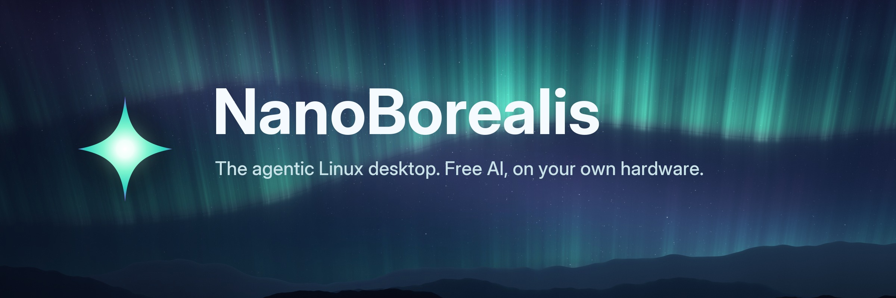
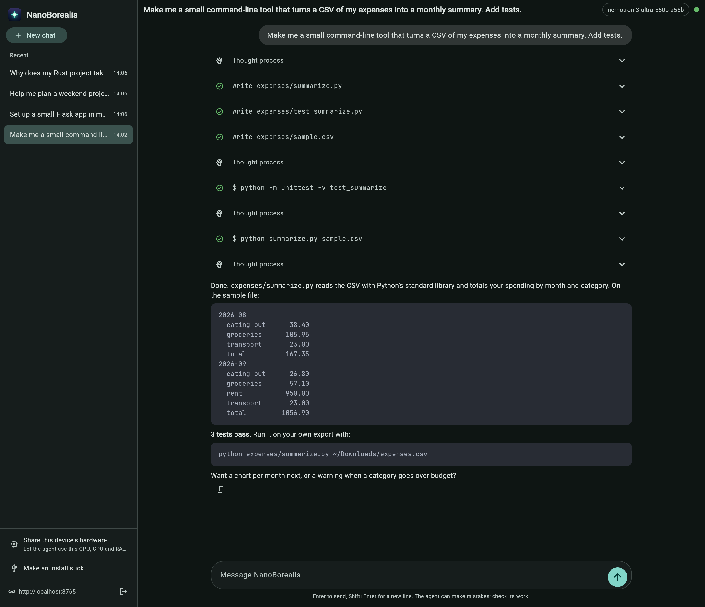
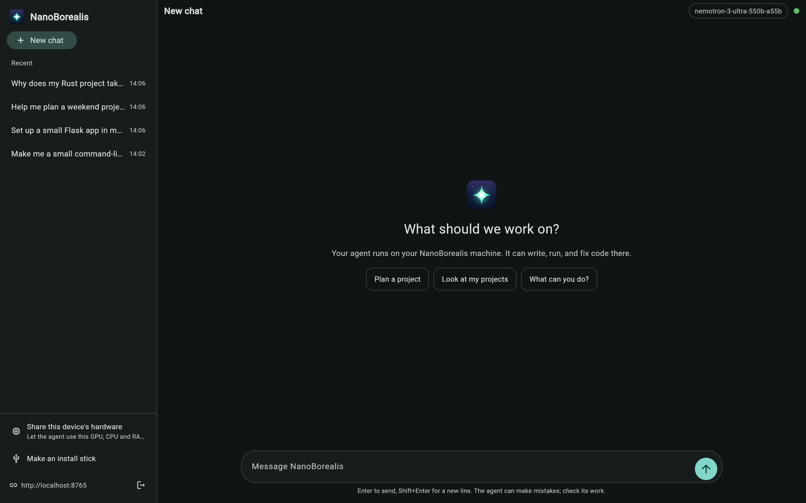
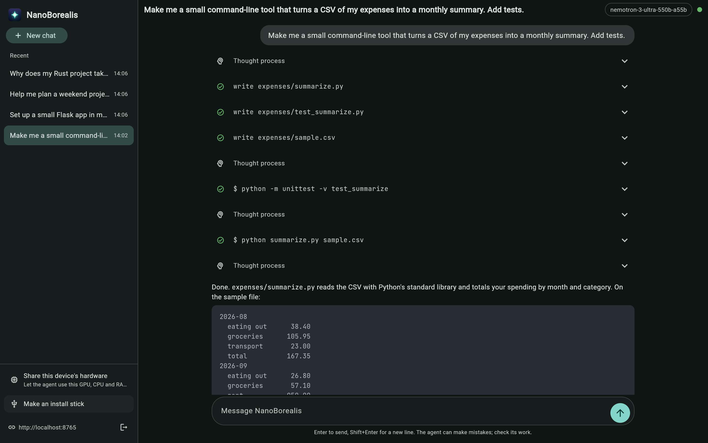

<p align="center">
  
</p>

<p align="center">
  <a href="https://github.com/korxspyre/nanoborealis/releases/latest"></a>
  <a href="https://github.com/korxspyre/nanoborealis/actions/workflows/build.yml"></a>
  <a href="LICENSE"></a>
</p>

**NanoBorealis** is a Linux desktop with an AI agent built in. The agent writes, runs and fixes code on your computer, and it's free: it runs on free cloud models and on the hardware you already own.

It's built on [Aurora](https://getaurora.dev), a polished KDE Plasma desktop on Fedora Atomic from the [Universal Blue](https://universal-blue.org) family. The agent is [nanobot](https://github.com/HKUDS/nanobot), running in a sandbox it can't escape to your files or your network.

NanoBorealis is made for people, not businesses. It's free, and it always will be: use it, change it, share it, and do whatever you like with it. That's why it's under the [PolyForm Noncommercial License 1.0.0](LICENSE), which keeps it from being turned into a product or a business. If you want to use it commercially, see [`docs/COMMERCIAL.md`](docs/COMMERCIAL.md). Parts that came from other projects keep their own licenses, listed in [NOTICE](NOTICE).

<p align="center">
  <a href="https://github.com/korxspyre/nanoborealis/releases/latest/download/NanoBorealis-Setup.exe"><b>Download for Windows</b></a>
  &nbsp;·&nbsp;
  <a href="https://github.com/korxspyre/nanoborealis/releases/latest/download/NanoBorealis-macos.dmg"><b>macOS</b></a>
  &nbsp;·&nbsp;
  <a href="https://github.com/korxspyre/nanoborealis/releases/latest/download/NanoBorealis-linux-x86_64.tar.gz"><b>Linux</b></a>
  <br>
  <sub>The NanoBorealis app: always the newest version. It also makes the install stick for you.</sub>
</p>

<p align="center">
  
</p>

## Why NanoBorealis

|  |  |
|---|---|
| ✦ **An agent, not a chatbot** | It has its own Linux environment with `sudo`, installs its own tools, and builds and tests real projects in a folder you share with it. |
| ✦ **Free to run** | It uses free models through [OpenRouter](https://openrouter.ai), with automatic fallback when one is busy. |
| ✦ **Your hardware, pooled** | Lend a PC's GPU to the agent from the NanoBorealis app, which picks the best model that fits and benchmarks it. Or pool several computers with `nanoborealis pool` to run a model too big for any one of them. The pool planner picks the most capable set of models your hardware can run at agent speed, and corrects its estimates from real benchmarks. |
| ✦ **Contained by design** | The agent runs rootless, in its own account, behind a firewall that keeps it off your local network. It has no rights on the operating system. |
| ✦ **A council of models** | Run several models at once on the pool. Each one is a seat with its own memory, and the seats meet in the Hall to discuss, share a task board and vote. |
| ✦ **Every device, one history** | Chat from the desktop, the WebUI, or the NanoBorealis app on any computer. Your chats live on your machine and show up everywhere. |
| ✦ **Updates you control** | Nothing updates by itself. Builds are tested on the dev channel, released to stable, then installed only when you say so, and the previous version stays one reboot away. |

## Get started

### With the NanoBorealis app

1. **Install the app**: [Windows](https://github.com/korxspyre/nanoborealis/releases/latest/download/NanoBorealis-Setup.exe) (run it), [macOS](https://github.com/korxspyre/nanoborealis/releases/latest/download/NanoBorealis-macos.dmg) (drag to Applications, then right-click and **Open** the first time), or [Linux](https://github.com/korxspyre/nanoborealis/releases/latest/download/NanoBorealis-linux-x86_64.tar.gz) (unpack, run `./install.sh`).
2. **Make an install stick**: pick a USB stick of 8 GB or more, paste your OpenRouter key, and the app downloads the installer straight onto the stick and checks it. (Windows and Linux.)
3. **Boot the new computer from the stick.** Its boot menu opens with **F9** on HP, **F12** on Dell and Lenovo, or **Option** on a Mac.
4. **Install**, and tick **Make this user administrator**.
5. **Log in.** Setup opens by itself and uses the key from the stick.
6. **Open NanoBorealis** from the app menu, and start a chat.

Use a **dedicated OpenRouter key with a low credit limit**: the agent can read its own key.

### By hand

1. Download the installer from the [latest release](../../releases/latest). It comes in parts; the release notes show how to join them and check the hash.
2. Write it to a USB stick with Fedora Media Writer, Rufus or balenaEtcher, and install as above. Setup asks for your OpenRouter key at first login.

**Already on Aurora?** Switch without reinstalling:

```bash
sudo bootc switch ghcr.io/korxspyre/nanoborealis:stable
systemctl reboot
```

**Installed before the move from `more-than-just-kyrion` to `korxspyre`?** Images are published under the new name now, so point the computer there once, then update as usual. Keep `-nvidia` if it has it, and use `dev` in place of `stable` if it follows the dev channel (a computer on the retired `testing` channel goes to `dev`):

```bash
sudo bootc switch ghcr.io/korxspyre/nanoborealis:stable
```

## Everyday use

```bash
nanoborealis help           # everything below, and more
nanoborealis update         # see what's new, then install it at the next reboot
nanoborealis rollback       # go back to the previous version
nanoborealis devices        # devices paired with the NanoBorealis app (pair: pick this computer in the app)
nanoborealis compute list   # devices lending their hardware to the agent
nanoborealis pool join      # pool this computer with others to run bigger models
nanoborealis council apply  # seat one agent per pooled model, meeting in the Hall
```

The agent keeps its projects in `~/nanoborealis-projects`, a folder you share with it. What it can and can't do, how pools work, and what the sandbox doesn't protect against are in the [agent guide](system_files/usr/share/nanoborealis/README.md). How the council works is in [`docs/council`](docs/council/README.md).

## The app

| | |
|---|---|
|  |  |
| Chat with your agent from any computer. It finds NanoBorealis machines on your network by itself. | Make an install stick, with your key on it. |

More about the app, including sharing a computer's GPU with the agent, is in [`client/`](client).

## How it's built

NanoBorealis is a [bootc](https://containers.github.io/bootc/) image: the whole OS is one signed container image, rebuilt from the latest Aurora every day.

- **Every build is checked** before it's published: [`tests/image-checks.sh`](tests/image-checks.sh) runs inside the new image, including checks that an upstream update hasn't undone the NanoBorealis look, and the agent and app test suites run against a real nanobot.
- **Two editions.** Every build comes as NanoBorealis and as NanoBorealis NVIDIA, which adds NVIDIA's open driver and container toolkit so the pool can run models on the GPU. There's one installer: a computer with an NVIDIA GPU moves itself to the NVIDIA edition at first login, and `nanoborealis update --nvidia` or `--standard` switches by hand.
- **Council.** Seats, the Hall and the app's Agent, Hall and Task modes: see [`docs/council`](docs/council/README.md).
- **Dev and stable.** One branch, `main`, and two channels, for the OS and the app alike. Every push to `main` (and the nightly rebuild of the OS) publishes the **dev** channel. A release is a tag: pushing `vX.Y.Z` (matching [`client/VERSION`](client/VERSION)) runs the [Release](.github/workflows/release.yml) workflow, which publishes the OS image as `:stable` and `:X.Y.Z` after the image checks pass, releases the app, and puts the installer and the app on the `vX.Y.Z` release. The app's install stick picks which channel a new computer follows, and `nanoborealis update --stable` or `--dev` moves an installed one. The app has the same two channels for its own updates.
- **Signed.** Images are signed with [cosign](https://github.com/sigstore/cosign), keyless, by this repository's own workflows. To verify one: `cosign verify --certificate-identity-regexp '^https://github.com/korxspyre/nanoborealis/' --certificate-oidc-issuer https://token.actions.githubusercontent.com ghcr.io/korxspyre/nanoborealis:stable`
- **Pools are proven** before they ship: CI splits one model across two [exo](https://github.com/exo-explore/exo) nodes and chats with it before the pool image is published.

| Directory | What's inside |
|---|---|
| [`system_files/`](system_files) | Everything NanoBorealis adds to Aurora: the agent kit, the network guard, commands, artwork |
| [`client/`](client) | The NanoBorealis app (Python, [Flet](https://flet.dev)), and how its installers are built |
| [`pool/`](pool) | The pool node: a pinned exo build |
| [`build_files/`](build_files) | The scripts the OS image build runs, and the small helper it compiles |
| [`disk_config/`](disk_config) | Settings for the disk and installer ISO builds |
| [`branding/`](branding) | The logo, and the scripts that paint the wallpaper, icons and this banner |
| [`tests/`](tests) | Checks that run inside every built image |
| [`docs/`](docs) | The council guide, the trademark policy, the commercial-license notice and the README screenshots |
| [`.github/workflows/`](.github/workflows) | Builds, tests, installer ISOs, app releases: every push to `main` publishes the dev channel, and a `vX.Y.Z` tag releases stable |

## Roadmap

- **Council on real hardware.** `council apply`, seats in real containers and the Hall behind the real firewall are tested against stand-ins; the first runs on a real pool are next, as are the NVIDIA, Windows (WSL2) and Android paths.
- **GPU pools in CI.** CI has no GPU, so the NVIDIA node is built and started there but proven only on real machines.
- **Login screen and welcome app.** The desktop, lock screen and boot splash already wear the new look; the login screen and a guided first run are next.
- **Signed macOS app, and install sticks from a Mac.**

## Credits

NanoBorealis stands on [Aurora](https://getaurora.dev) and [Universal Blue](https://universal-blue.org), [nanobot](https://github.com/HKUDS/nanobot) by HKUDS, [exo](https://github.com/exo-explore/exo), [Flet](https://flet.dev) and [OpenRouter](https://openrouter.ai). The wordmark is set in [Inter](https://rsms.me/inter/), and code in the app in [JetBrains Mono](https://www.jetbrains.com/lp/mono/).

Licensed under the [PolyForm Noncommercial License 1.0.0](LICENSE). Every source file names its license in an `SPDX-License-Identifier` line: a few build files from the Universal Blue template stay under Apache-2.0, and the Plasma theme under GPL-2.0-or-later. [NOTICE](NOTICE) lists the parts that keep their own licenses, and [LICENSES](LICENSES) holds the text of each license that applies to any part. Every installer, the OS image and the pool node carry the license, and the app links to the source under **App updates**. The name and logo aren't part of that license: see [TRADEMARK](docs/TRADEMARK.md).
<sub>Formerly known as nanobot OS and NanoAurora. Systems set up under those names move over by themselves.</sub>
